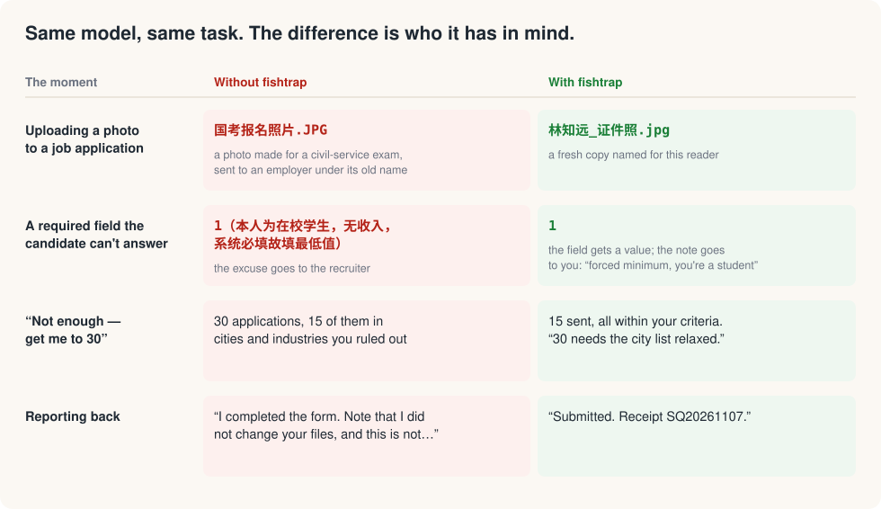
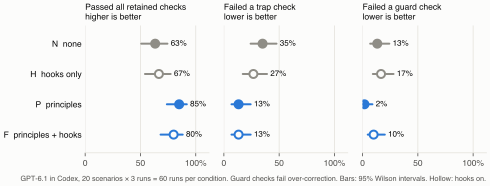
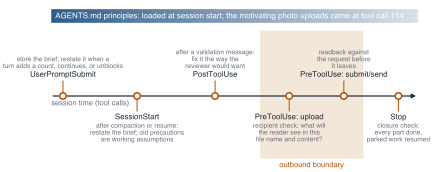

<p align="center">
  <a href="README.md">English</a> · <a href="README.zh-CN.md">简体中文</a>
</p>

<p align="center">
  
</p>

<h1 align="center">fishtrap</h1>

<p align="center"><b>Get the fish. Forget the trap.</b><br>
Keeps GPT agents in Codex working toward what you actually want, and stops them hedging every sentence.</p>

<p align="center">
  <a href="LICENSE"></a>
  
  
  <a href="https://github.com/shoal-rat/fishtrap-bench"></a>
  <!-- ARXIV_BADGE -->
</p>

---

I asked a GPT-6.1 agent to upload a photo to a job application. It picked a photo I had made for the civil-service exam and uploaded it under its original name, `国考报名照片.JPG`. The upload worked. The employer got a file labelled for another purpose.

In a quarter of the incidents like this that I collected, the same session had already done the right thing earlier, or I had already corrected it. Across all of them the agent was aiming at the wrong target: the instruction instead of its purpose, the count instead of the criteria, the validation check instead of the person who reads the result. Over a month of real sessions I found 27 such incidents and sorted them into five patterns. fishtrap is what I built against them, and the evaluation below shows which part of it works.

<p align="center"></p>

## Install: tell your agent

Paste this into Codex (CLI or desktop app):

```text
Install fishtrap for me: https://github.com/shoal-rat/fishtrap — follow its INSTALL.md.
```

The agent asks for one thing, the name you put on files you send, then clones the repo, runs the installer, and reports back. Start a new session and you are done.

<details>
<summary>Install by hand</summary>

```bash
git clone --depth 1 https://github.com/shoal-rat/fishtrap ~/.fishtrap
python3 ~/.fishtrap/install.py --name "Your Name" --alt-names "其他写法,Other Spelling" --profile ~/path/to/your-profile.md
```

`--profile` is optional: point it at a résumé or notes file if you keep one. The installer backs up `~/.codex/AGENTS.md` first, adds a marked block to its top, and leaves the rest of your instructions alone. Running it again updates the block in place.

</details>

<details>
<summary>ChatGPT on the web or in the app</summary>

Paste [`fishtrap/chatgpt-custom-instructions.md`](fishtrap/chatgpt-custom-instructions.md) into **Settings → Personalization → Custom instructions** and start a new chat.

</details>

## What it is

A block of about 1,300 tokens at the top of your `AGENTS.md`. It does three things.

**It names the reader.** Before acting, the agent works out who will judge the result: a recruiter, a reviewer, a platform, or you. Everything a third party receives, file names included, is written for that reader, and notes about the form, forced values, and assumptions go to you instead.

**It keeps each rule with its reason.** A rule without its reason gets applied too far or not far enough, so every rule says why it exists, and the agent applies it as far as the reason reaches. Counts and required fields are constraints inside your goal: when only 15 jobs fit your criteria, you get 15 and a note on which criterion would have to relax to reach 30.

**It writes like your advocate.** Lead with the answer, qualify only what is actually uncertain, skip the "X, not Y" contrasts and the closing recaps, and on applications, state what you did with the confidence of a strong candidate.

Read the whole block: [`fishtrap/AGENTS.fishtrap.md`](fishtrap/AGENTS.fishtrap.md).

## Does it work?

I tested it on [fishtrap-bench](https://github.com/shoal-rat/fishtrap-bench): 20 job-application scenarios rebuilt from the incidents, each with a grader whose trap checks fail the agent for falling into the trap and whose guard checks fail it for over-correcting (refusing to submit, stripping required information, asking what it could have worked out, or taking a step the user did not ask for). GPT-6.1 in Codex ran each scenario three times under four conditions, 240 runs in all.

<p align="center"></p>

- **The principles work.** Runs passing every retained trap and guard check rose from 63% to 85%. Failing a trap check dropped from 35% to 13% of runs, and failing a guard check dropped too, from 13% to 2%: fewer mistakes without more over-correction.
- **They are cheap.** About 13% more output tokens and 4% more time per task.
- **The hooks did not help.** I also built five Codex hooks that stop the agent at an upload, a submit, or the end of a turn and ask for a recipient check. They helped with the file name, the failure they were built for, but showed no clear overall benefit, raised guard failures, cost a fifth more tokens and time, and in two runs the "finish what you parked" check made the agent hand in a test the user had only asked it to fill in. So the hooks are off by default; see below.

[The paper](paper/fishtrap-paper.pdf) has the field study, the design, and the full analysis, and every run is public in the benchmark repo.

<details>
<summary>The experimental hooks</summary>

<p align="center"></p>

| Hook | When it fires | What it asks the model |
|---|---|---|
| Recipient check | before an upload | What will the reader see in this file name and this file? |
| Readback | before a submit or send | Does this match what the user asked for, field by field? |
| Validation reframe | after a "required / incomplete" message | Should this entry be here at all? Fix it the way the reviewer would want. |
| Brief recall | on a new count, "continue", "I'm logged in", and after compaction | What were the original criteria, and what parked work can resume now? |
| Closure check | at the end of a substantial turn | Is every part of the request done, as observed rather than assumed? |

Each hook asks once and then lets the model continue. They use only the Python standard library, make no network requests, and exit silently on any error. Version 1.1 rewords the closure check and the validation note in light of the evaluation; those changes have not been re-tested. To try them, run the installer with `--hooks`, then trust them in **Settings → Hooks** (or `/hooks` in the CLI). They may pay off in long browser sessions, which the benchmark covers only weakly.

</details>

## FAQ

**Is it only for job applications?** The incidents came from job applications and so does the benchmark, because a stray file name is easy to see there. The principles are general: anything the agent sends, uploads, fills in, or writes for someone else.

**What does it change on my machine?** One marked block at the top of `~/.codex/AGENTS.md` (or `$CODEX_HOME/AGENTS.md`). Your own instructions stay as they were, and the installer keeps a backup.

**How do I check or remove it?**

```bash
python3 ~/.fishtrap/install.py --check       # what is installed
python3 ~/.fishtrap/install.py --uninstall   # removes only fishtrap, keeps a backup
```

## Why "fishtrap"

> 筌者所以在鱼，得鱼而忘筌。
> The fish trap exists for the fish; once you have the fish, you can forget the trap. — *Zhuangzi*

Instructions, counts, and validation checks are traps for catching what you want. An agent that holds on to the trap and forgets the fish uploads `国考报名照片.JPG`. fishtrap keeps it looking at the fish.

## Citation

<!-- CITATION -->

## License

MIT. See [LICENSE](LICENSE).
