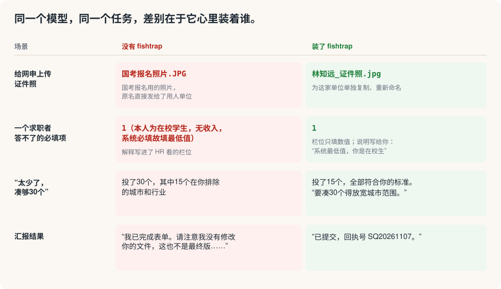
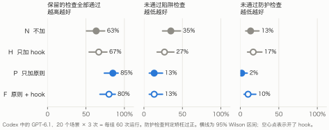
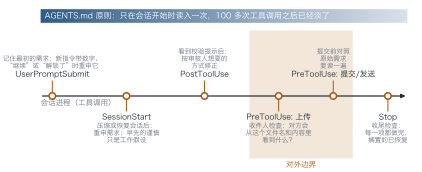

<p align="center">
  <a href="README.md">English</a> · <a href="README.zh-CN.md">简体中文</a>
</p>

<p align="center">
  
</p>

<h1 align="center">fishtrap · 得鱼忘筌</h1>

<p align="center"><b>得鱼而忘筌。</b><br>
让 Codex 里的 GPT 盯着你真正想要的结果干活，也不再句句设防。</p>

<p align="center">
  <a href="LICENSE"></a>
  
  
  <a href="https://github.com/shoal-rat/fishtrap-bench"></a>
  <!-- ARXIV_BADGE -->
</p>

---

我让 GPT-6.1 帮我给一份网申上传证件照。它挑了一张我报国考时准备的照片，连原文件名一起传了上去：`国考报名照片.JPG`。上传成功了，HR 收到的却是一个写着别的用途的文件。

我收集的这类事故里，有四分之一在同一个会话里它前面其实做对过，或者我已经纠正过它。这些事故的共同点是瞄错了靶子：盯着指令本身而忘了指令的目的，盯着数量而忘了标准，盯着校验提示而忘了最后看结果的人。我翻了一个月的真实会话，找出 27 起这样的事故，归为五类。fishtrap 就是针对它们做的，下面的评测说明了其中哪一部分真正管用。

<p align="center"></p>

## 安装：交给你的 GPT

把这句话发给 Codex（CLI 或桌面版都行）：

```text
帮我安装 fishtrap：https://github.com/shoal-rat/fishtrap ，按它的 INSTALL.md 来。
```

它只会问你一件事：你对外发文件时用的名字。然后它自己克隆仓库、运行安装脚本、向你汇报。开一个新会话就生效了。

<details>
<summary>手动安装</summary>

```bash
git clone --depth 1 https://github.com/shoal-rat/fishtrap ~/.fishtrap
python3 ~/.fishtrap/install.py --name "你的名字" --alt-names "Your Name,其他写法" --profile ~/path/to/your-profile.md
```

`--profile` 可以不填；如果你有简历或个人信息文件，就指向它。安装脚本会先备份 `~/.codex/AGENTS.md`，在顶部加一段带标记的内容，你原有的指令一字不动。重复运行会原地更新。

</details>

<details>
<summary>网页版或 App 里的 ChatGPT</summary>

把 [`fishtrap/chatgpt-custom-instructions.md`](fishtrap/chatgpt-custom-instructions.md) 的内容粘贴到 **设置 → 个性化 → 自定义指令**，再开新对话。

</details>

## 它是什么

放在 `AGENTS.md` 顶部的一段约 1300 个 token 的原则，做三件事。

**点明读者。** 动手之前，先想清楚结果由谁来评判：HR、审核人、平台，还是你自己。凡是第三方会收到的东西，包括文件名，都按那个读者来写；关于表单的说明、被迫填的数值、做过的假设，都写给你，不写进栏位。

**每条规则都带着理由。** 规则一旦脱离理由，就会用过头或者用不到位。所以每条规则都写明了为什么，GPT 只把它用到理由所及的范围。数量和必填项是你目标之内的约束：符合你标准的岗位只有 15 个，它就投 15 个，并告诉你要凑到 30 个得放宽哪一条。

**站在你这边写。** 先说结论，只对真正不确定的地方加限定，不写“不是 X，而是 Y”，不写结尾总结；写申请材料时，用一个强有力候选人的笃定口吻陈述你做过的事。

原则全文见 [`fishtrap/AGENTS.fishtrap.md`](fishtrap/AGENTS.fishtrap.md)。

## 效果如何

我在 [fishtrap-bench](https://github.com/shoal-rat/fishtrap-bench) 上做了测试：20 个由真实事故改编的网申场景，每个都配有判分器：陷阱检查判定是否掉进陷阱，防护检查判定是否矫枉过正，比如不敢提交、删掉必须提供的信息、问一些自己能推断的问题，或者擅自做了用户留给自己的步骤。Codex 里的 GPT-6.1 在四种条件下把每个场景各跑三次，共 240 次。

<p align="center"></p>

- **原则管用。** 保留的陷阱与防护检查全部通过的比例从 63% 升到 85%。陷阱检查失败从 35% 降到 13%，防护检查失败也从 13% 降到 2%：犯错少了，也没有矫枉过正。
- **代价很小。** 每个任务多约 13% 的输出 token、4% 的时间。
- **hook 没有帮上忙。** 我还做了五个 Codex hook，在上传、提交和一轮结束时拦一下，让 GPT 做收件人检查。它们对专门针对的文件名问题有帮助，但整体看不出明显提升，防护检查失败反而变多，还多花了约五分之一的 token 和时间。另外有两次，“把搁置的事做完”这条检查让 GPT 擅自交了卷，而交卷是用户说好留给自己的。所以 hook 默认不装，详见下面。

论文里有完整的事故研究、设计和分析；每一次运行记录都公开在评测仓库里。

<details>
<summary>实验性的 hook</summary>

<p align="center"></p>

| Hook | 什么时候触发 | 让模型想什么 |
|---|---|---|
| 收件人检查 | 上传文件之前 | 对方会从这个文件名、这个文件里看到什么？ |
| 提交前复读 | 提交或发送之前 | 逐项对照，和用户要的一致吗？ |
| 校验提示重构 | 出现“必填 / 不完整”提示之后 | 这一条本该在这里吗？按审核人希望的方式改。 |
| 需求重申 | 新指令带数字、说“继续”“登录好了”，以及会话压缩之后 | 最初的标准是什么？哪些搁置的事现在可以接着做？ |
| 收尾检查 | 一轮较长的工作结束时 | 请求的每一部分都做完了吗？以实际看到的为准。 |

每个 hook 只问一次，然后放模型继续做；只用 Python 标准库，不联网，出错时安静退出。1.1 版根据评测结果改写了收尾检查和校验提示两条措辞，这些改动还没有重新测试。想试用的话，运行安装脚本时加 `--hooks`，然后在 **设置 → Hooks**（CLI 里是 `/hooks`）信任它们。它们在很长的浏览器会话里也许有用，而这正是评测覆盖得不够的地方。

</details>

## 常见问题

**只适用于网申吗？** 事故来自网申，评测也是，因为文件名起错的代价在这里最直观。原则本身是通用的：凡是 GPT 替你发出、上传、填写或写给别人的东西都适用。

**它会改动我电脑上的什么？** 只在 `~/.codex/AGENTS.md`（或 `$CODEX_HOME/AGENTS.md`）顶部加一段带标记的内容。你自己的指令原样保留，安装前会备份。

**怎么检查或卸载？**

```bash
python3 ~/.fishtrap/install.py --check       # 查看安装情况
python3 ~/.fishtrap/install.py --uninstall   # 只移除 fishtrap，并保留备份
```

## 为什么叫 fishtrap

> 筌者所以在鱼，得鱼而忘筌。——《庄子·外物》

指令、数量要求、校验规则，都是用来捕鱼的筌。抱着筌忘了鱼的 GPT，就会把 `国考报名照片.JPG` 传给 HR。fishtrap 让它的眼睛一直盯着鱼。

## 引用

<!-- CITATION -->

## 许可证

MIT，见 [LICENSE](LICENSE)。
